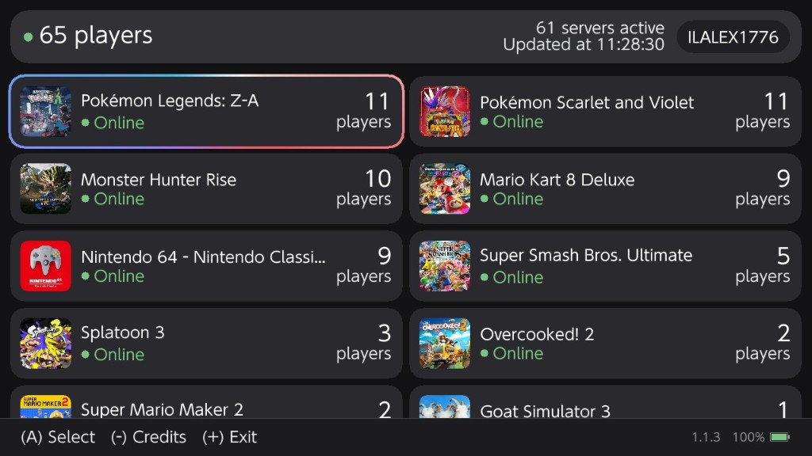
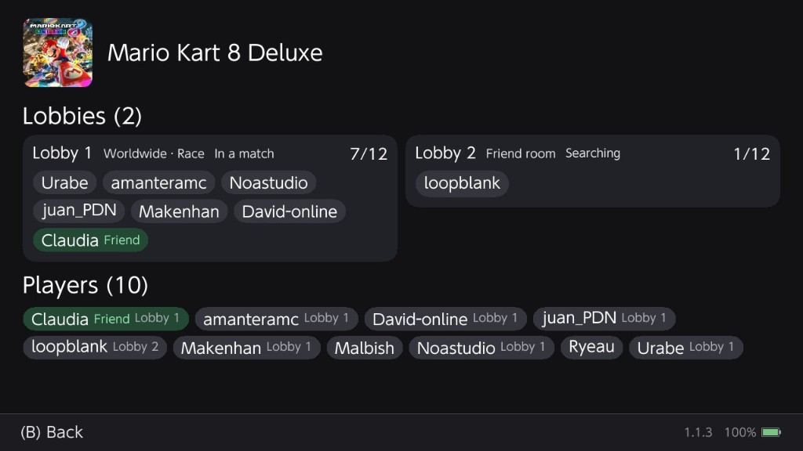

# NexStatus

NexStatus is a Nintendo Switch homebrew application for [Nextendo](https://nextendo.network) server status. It lists game servers, player counts, and, after sign-in, lobbies and players. An [Ultrahand](https://github.com/ppkantorski/Ultrahand-Overlay) overlay shows the same public counts.

NexStatus is not affiliated with Nintendo or Nextendo.

## Install

The release is one zip. Extract it at the root of the SD card.

| Path | Contents |
| --- | --- |
| `switch/nexstatus.nro` | Homebrew Menu application |
| `switch/.overlays/nexstatus.ovl` | Ultrahand overlay |

The Homebrew Menu is required for the application. Ultrahand is required for the overlay. Overlay files must be in `sdmc:/switch/.overlays/`.

## Application

Open NexStatus from the Homebrew Menu.

The main screen lists game servers, busiest first. Each entry shows the game icon, name, server state, and player count. The header shows the number of players online, the number of active servers, and the time of the last count update. Counts refresh about every 15 seconds.



The account control is in the header.

- Signed out: **A** opens sign-in. The console shows a code and a QR code. The phone completes sign-in. The console does not open a browser.
- Signed in: **A** opens the account screen, which shows the username and friend code. **X** logs out.

**A** on a server opens that game. Signed out, the page asks for sign-in. Signed in, it shows lobbies and players from Nextendo, including mode, room state, occupied slots, and a friend marker. The page loads on open and refreshes about every 15 seconds while it stays open. **B** returns to the list.



**(−)** on the main screen opens credits. It does nothing on other screens. **(+)** exits. The bottom right shows the version and the battery level.

### Updates

On launch the application checks GitHub for a newer release. If one is available, an update dialog is shown.

- **A** downloads and installs it. The dialog shows progress.
- **(+)** does nothing while the download is in progress.
- On success, the dialog asks for **A** to close the application. Start it again from the Homebrew Menu.
- On failure, **A** retries.

The installer uses `nexstatus.zip` and replaces both `switch/nexstatus.nro` and `switch/.overlays/nexstatus.ovl`.

## Overlay

Open Ultrahand, then NexStatus. The overlay lists the public player total and one row per game, busiest first. It refreshes about every 15 seconds while it is open and does not request data while it is closed. It does not show lobbies or account data.

## Build

Install [devkitPro](https://devkitpro.org/) with `switch-dev`, `switch-sdl2`, `switch-sdl2_ttf`, `switch-libjpeg-turbo`, `switch-curl`, and `switch-mbedtls`. From the repository root:

```sh
make
```

This builds the application and the overlay and writes `nexstatus.zip` at the repository root. `make clean` removes the build output and the zip.

`APP_VERSION` in the root Makefile is the version stored in the application. A release tag must be newer than the installed version for the console to offer the update.

## License

GNU General Public License v2.0. See [LICENSE](LICENSE).

The overlay UI uses [libtesla](https://github.com/WerWolv/libtesla), which includes Sean Barrett's stb_truetype (public domain).

## Acknowledgements

- [devkitPro](https://devkitpro.org/) and [libnx](https://github.com/switchbrew/libnx)
- [SDL2](https://www.libsdl.org/) and SDL2_ttf
- [libcurl](https://curl.se/) and [libjpeg-turbo](https://libjpeg-turbo.org/)
- [WerWolv](https://github.com/WerWolv), for libtesla
- [ppkantorski](https://github.com/ppkantorski/Ultrahand-Overlay), for Ultrahand
- [Nextendo](https://nextendo.network), for the status API
